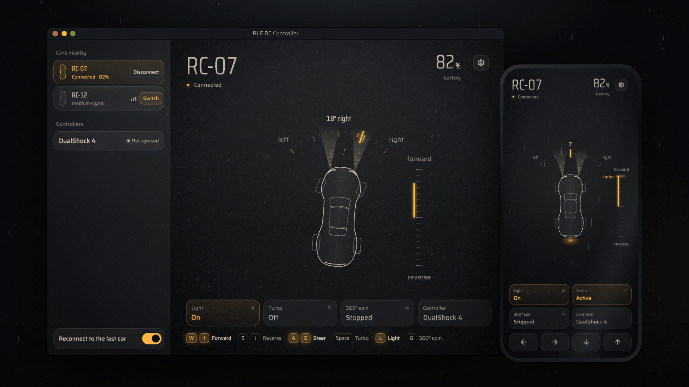

# BLE RC Controller

**English** · [Español](README.es.md) · [Português](README.pt-BR.md)

Drive Bluetooth LE toy RC cars with a **gamepad** (DualShock 4, DualSense, Xbox, Switch Pro and others), a **keyboard** or on-screen **touch buttons** — from your computer or your Android phone.



The car's own companion app only runs on phones. This app talks to the same Bluetooth interface, so you can use a real controller instead.

> **Unofficial project.** It is independent, open source (MIT) and **not affiliated with, endorsed by or sponsored by** Shell or any other car, toy or fuel brand. "Shell" and all other names belong to their respective owners and are used here only to say which cars this app works with. See [Disclaimer](#disclaimer).

## Compatible cars

- **Shell Bluetooth RC cars** (the ones sold at Shell fuel stations). Verified with two models (SF-25 and 296 GT3); the other models appear to use the same Bluetooth interface and should work. Reports are welcome.
- **More cars are coming.** Support for other Bluetooth LE toy cars will be added over time; see [CONTRIBUTING.md](CONTRIBUTING.md) to help.

## Features

- A dark **dashboard** with a line-drawn top view of the car, a steering gauge and a throttle scale.
- Finds nearby cars automatically and lets you **pick which car** to drive (several can be on at once).
- **Gamepad support** for the most common controllers, plus a **"Teach a new controller"** wizard and **Live signals** for controllers the app does not know.
- **Remap every button.** Each action (forward, reverse, left, right, light, turbo, 360° spin) can have several inputs: controller buttons, stick directions, keyboard keys.
- **Keyboard** control (WASD / arrow keys by default) and **on-screen buttons** for touch screens.
- Battery level, signal strength, automatic reconnection to your last car. If the connection drops, the app reconnects by itself.
- Safety: the car stops when you disconnect, switch apps, or lose the controller.
- Available in **English, Español and Português**.

## Platforms

| Platform | Status |
|---|---|
| macOS | 🟡 Built and opened in 1.1.0, but this build has not been driven with a car. Earlier builds were verified with one car model and a DualShock 4. |
| Android | ✅ Verified on a tablet (Android 16) with two cars (SF-25, 296 GT3) and a DualShock 4. |
| Windows | 🟡 Builds in CI; not yet tested on a real PC — reports welcome. |
| iOS | ❌ Not supported. |

## Download

Get the latest build for your system from the [**Releases**](../../releases) page:

- **Android:** `ble-rc-controller-<version>-android.apk` (allow "install unknown apps" for your browser/files app).
- **macOS:** `ble-rc-controller-<version>-macos.zip`. The app is not notarized, so the first time: right-click → **Open**.
- **Windows:** `ble-rc-controller-<version>-windows.zip`. Unzip and run `ble_rc_controller.exe`. If SmartScreen warns you: **More info → Run anyway**.

## Quick start

1. **Close the car's official app** on your phone — the car accepts only one connection at a time.
2. Turn the car on and open **BLE RC Controller**. The car appears under **Cars nearby** (names start with `SL-`). Click or tap **Connect**.
3. Pair your controller with Bluetooth (or plug it in) and press any button. It shows up under **Controllers** in **Settings** (the gear), and in the garage column on a computer.
4. Drive.

### Default controls

| Action | Controller | Keyboard |
|---|---|---|
| Forward | Right trigger (R2 / RT) | ↑ or W |
| Reverse | Left trigger (L2 / LT) | ↓ or S |
| Left / Right | Left stick or D-pad | ← → or A D |
| Light (on/off) | Bottom button (✕ / A) | L |
| Turbo (hold) | Right button (○ / B) | Space |
| 360° spin (hold) | Top button (△ / Y) | Q |

Pushing the left stick up/down does **not** drive by default. If you like that, add it in **Settings → Buttons and keys** (*Forward* → Add → push the stick up).

On the on-screen buttons, **Light**, **Turbo** and **360° spin** switch on and off with each tap.

All of this is editable in **Settings → Buttons and keys**. Everything is on/off: the car has no proportional speed or steering.

## Supported controllers

Controllers are recognised by a built-in mapping database, so layouts such as **PlayStation (DualShock 4 / DualSense), Xbox and Switch Pro** work out of the box on the platforms where the OS exposes them as gamepads.

For anything else open **Settings → Controllers → Teach a new controller** and press the button the app asks for, one by one: 18 steps in 5 groups, with the part to press lit on a drawing of the controller (skip what your controller does not have). You can also use **Live signals** (same screen) to see raw signals, and assign a raw signal to an action directly with **Settings → Buttons and keys → Add**.

## Keyboard and touch

- Keyboard input only counts while the app window is in front.
- **Settings → On-screen buttons** turns on touch buttons (default on Android). Several buttons can be held at once.
- On a computer, the key legend under the dashboard shows the keys in use. **Settings** opens as a side panel; Esc or a click outside closes it.

## Troubleshooting

- **The car does not show up** — turn it off and on, close the official app on every phone, and make sure Bluetooth is on. On Android grant the "Nearby devices" permission.
- **"Could not connect to …"** — another device is probably connected to the car.
- **Controller not detected** — pair it first, then press a button. On Windows, a DualShock 4 may not be reported as a gamepad by the OS; tools such as Steam Input or DS4Windows make it look like an Xbox controller, or use the **Teach a new controller** wizard.
- **A button does nothing** — check **Live signals** (**Settings → Controllers**). If the signal shows up there, bind it with **Settings → Buttons and keys → Add**.

## Build from source

You need [Flutter](https://docs.flutter.dev/get-started/install) (stable, 3.47 or newer).

```bash
flutter pub get
flutter test
flutter run -d macos     # or: -d windows / -d <android device>
flutter build apk --release
```

Translations live in `lib/l10n`. Edit `tool/gen_arb.py` (single source for all three languages), then run `python3 tool/gen_arb.py && flutter gen-l10n`.

## How it works

The car exposes a Bluetooth LE service with one write-only characteristic that takes an **8-byte packet**. The app sends that packet whenever your inputs change, and at least five times a second as a keep-alive. Details in [docs/PROTOCOL.md](docs/PROTOCOL.md).

## Contributing

Issues and pull requests are welcome — especially test reports from real hardware (other car models, Android, Windows, other controllers). See [CONTRIBUTING.md](CONTRIBUTING.md).

## Disclaimer

This is an independent interoperability project. It does not contain, distribute or depend on any code or assets from the car's manufacturer or its app, and it uses no logos. Brand names appear only to describe compatibility. Use it at your own risk: the car can move suddenly, so use it in a clear area. Laws on reverse engineering and interoperability vary by country; nothing here is legal advice.

## License

[MIT](LICENSE)
