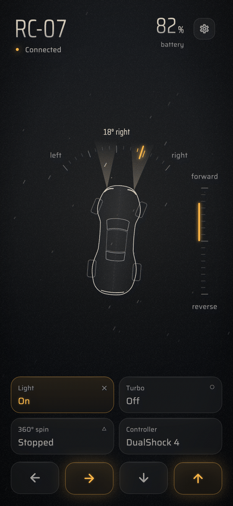
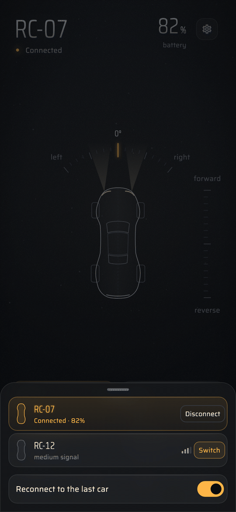
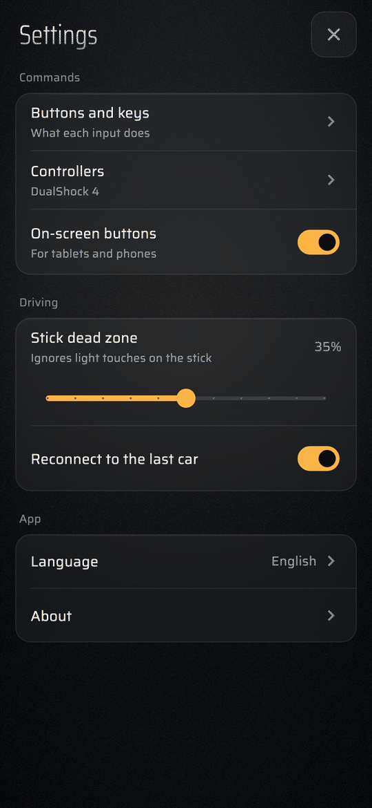

# BLE RC Controller

[English](README.md) · [Español](README.es.md) · **Português**

Pilote carrinhos de controle remoto com Bluetooth LE usando um **controle** (DualShock 4, DualSense, Xbox, Switch Pro e outros), o **teclado** ou **botões de toque** na tela — no computador ou no celular Android.


O app oficial do carrinho só roda em celulares. Este app usa a mesma interface Bluetooth, então você pode usar um controle de verdade.

> **Projeto não oficial.** É independente, de código aberto (MIT) e **não é afiliado, endossado nem patrocinado** pela Shell nem por nenhuma outra marca de carros, brinquedos ou combustíveis. "Shell" e todos os outros nomes pertencem aos seus respectivos donos e são usados aqui apenas para dizer com quais carrinhos este app funciona. Veja o [Aviso legal](#aviso-legal).

## Carrinhos compatíveis

- **Carrinhos RC Bluetooth da Shell** (os vendidos nos postos Shell). Verificado com dois modelos (SF-25 e 296 GT3); os outros modelos parecem usar a mesma interface Bluetooth e devem funcionar. Relatos são bem-vindos.
- **Mais carrinhos virão.** O suporte a outros carrinhos de brinquedo Bluetooth LE será ampliado aos poucos; veja o [CONTRIBUTING.md](CONTRIBUTING.md) para ajudar.

## Recursos

- Um **painel** escuro com uma vista de cima do carro desenhada com linhas, um indicador de direção e uma escala de aceleração.
- Encontra os carrinhos por perto e deixa você **escolher qual pilotar** (pode haver vários ligados).
- **Suporte aos controles mais comuns**, com um assistente **"Ensinar um controle novo"** e **Sinais ao vivo** para controles que o app não conhece.
- **Remapeie todos os botões.** Cada ação (frente, ré, esquerda, direita, luz, turbo, giro 360°) aceita várias entradas: botões do controle, direções do analógico e teclas.
- Controle pelo **teclado** (WASD / setas por padrão) e **botões na tela** para telas de toque.
- Nível de bateria, intensidade do sinal e reconexão automática ao último carro. Se a conexão cair, o app reconecta sozinho.
- Segurança: o carro para quando você desconecta, troca de app ou perde o controle.
- Disponível em **English, Español e Português**.

<p align="center">
  
  
  
</p>

## Plataformas

| Plataforma | Situação |
|---|---|
| macOS | ✅ Testado com os carrinhos e um DualShock 4. |
| Android | ✅ Verificado em um tablet (Android 16) com dois carrinhos (SF-25, 296 GT3) e um DualShock 4. |
| Windows | ✅ Testado em um PC com os carrinhos e um DualShock 4. |
| iOS | ❌ Não suportado. |

## Download

Baixe a versão mais recente para o seu sistema na página de [**Releases**](../../releases):

- **Android:** `ble-rc-controller-<version>-android.apk` (permita "instalar apps desconhecidos" para o navegador/gerenciador de arquivos).
- **macOS:** `ble-rc-controller-<version>-macos.zip`. O app não é notarizado; na primeira vez: botão direito → **Abrir**.
- **Windows:** `ble-rc-controller-<version>-windows.zip`. Extraia e execute `ble_rc_controller.exe`. Se o SmartScreen avisar: **Mais informações → Executar assim mesmo**.

## Primeiros passos

1. **Feche o app oficial do carrinho** no celular — o carro aceita só uma conexão por vez.
2. Ligue o carrinho e abra o **BLE RC Controller**. O carro aparece em **Carros por perto** (os nomes começam com `SL-`). Clique ou toque em **Conectar**.
3. Pareie o controle por Bluetooth (ou ligue por USB) e aperte qualquer botão. Ele aparece em **Controles**, dentro de **Ajustes** (a engrenagem), e na coluna da garagem no computador.
4. Pilote!

### Controles padrão

| Ação | Controle | Teclado |
|---|---|---|
| Frente | Gatilho direito (R2 / RT) | ↑ ou W |
| Ré | Gatilho esquerdo (L2 / LT) | ↓ ou S |
| Esquerda / Direita | Analógico esquerdo ou D-pad | ← → ou A D |
| Luz (liga/desliga) | Botão de baixo (✕ / A) | L |
| Turbo (segurar) | Botão da direita (○ / B) | Espaço |
| Giro 360° (segurar) | Botão de cima (△ / Y) | Q |

Empurrar o analógico esquerdo para cima/baixo **não** pilota por padrão. Se você gosta disso, adicione em **Ajustes → Botões e teclas** (*Frente* → Adicionar → empurre o analógico para cima).

Nos botões da tela, **Luz**, **Turbo** e **Giro 360°** ligam e desligam a cada toque.

Tudo é editável em **Ajustes → Botões e teclas**. Tudo é liga/desliga: o carrinho não tem velocidade nem direção proporcionais.

## Controles suportados

Os controles são reconhecidos por um banco de mapeamentos embutido, então os layouts **PlayStation (DualShock 4 / DualSense), Xbox e Switch Pro** funcionam direto nas plataformas em que o sistema os expõe como gamepad.

Para qualquer outro, abra **Ajustes → Controles → Ensinar um controle novo** e aperte, um a um, o botão que o app pedir: 18 passos em 5 grupos, com a peça a apertar acesa num desenho do controle (pule o que o seu controle não tiver). Você também pode usar **Sinais ao vivo** (na mesma tela) para ver os sinais brutos e atribuir um sinal direto a uma ação em **Ajustes → Botões e teclas → Adicionar**.

## Teclado e toque

- O teclado só vale com a janela do app em primeiro plano.
- **Ajustes → Botões na tela** liga os botões de toque (padrão no Android). Dá para segurar vários ao mesmo tempo.
- No computador, a legenda de teclas sob o painel mostra as teclas em uso. Os **Ajustes** abrem num painel lateral; Esc ou um clique fora fecha.

## Solução de problemas

- **O carro não aparece** — desligue e ligue, feche o app oficial em todos os celulares e confira se o Bluetooth está ligado. No Android, conceda a permissão de "Dispositivos próximos".
- **"Não foi possível conectar ao …"** — provavelmente outro aparelho está conectado ao carro.
- **Controle não detectado** — pareie primeiro e depois aperte um botão. No Windows, o sistema pode não reconhecer o DualShock 4 como gamepad; ferramentas como Steam Input ou DS4Windows fazem ele parecer um controle Xbox, ou use o assistente **Ensinar um controle novo**.
- **Um botão não faz nada** — olhe **Sinais ao vivo** (**Ajustes → Controles**). Se o sinal aparecer lá, atribua em **Ajustes → Botões e teclas → Adicionar**.

## Compilar a partir do código

Você precisa do [Flutter](https://docs.flutter.dev/get-started/install) (stable, 3.47 ou mais novo).

```bash
flutter pub get
flutter test
flutter run -d macos     # ou: -d windows / -d <aparelho android>
flutter build apk --release
```

As traduções ficam em `lib/l10n`. Edite `tool/gen_arb.py` (fonte única dos três idiomas) e rode `python3 tool/gen_arb.py && flutter gen-l10n`.

## Como funciona

O carrinho expõe um serviço Bluetooth LE com uma característica só de escrita que recebe um **pacote de 8 bytes**. O app envia esse pacote sempre que suas entradas mudam, e pelo menos cinco vezes por segundo como sinal de vida. Detalhes em [docs/PROTOCOL.pt-BR.md](docs/PROTOCOL.pt-BR.md).

## Contribuindo

Issues e pull requests são bem-vindos — principalmente relatos de teste em hardware real (outros modelos de carrinho, Android, Windows, outros controles). Veja [CONTRIBUTING.md](CONTRIBUTING.md).

## Aviso legal

É um projeto independente de interoperabilidade. Não contém, distribui nem depende de código ou arquivos do fabricante do carrinho ou do app dele, e não usa logotipos. Nomes de marcas aparecem apenas para descrever a compatibilidade. Use por sua conta e risco: o carro pode se mexer de repente, então use em área livre. As leis sobre engenharia reversa e interoperabilidade variam por país; nada aqui é orientação jurídica.

## Licença

[MIT](LICENSE)

## Privacidade

O app não coleta dados pessoais e não se conecta à internet. Veja a [política de privacidade](PRIVACY.pt-BR.md).

---

<a href="https://nextgti.com.br"></a>

Um projeto da [NextGTI](https://nextgti.com.br), de São Paulo.
